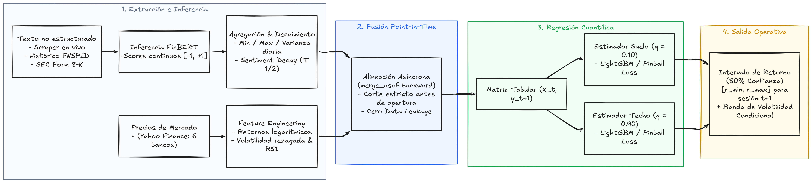

# Motor Predictivo Híbrido de Mercados Financieros (TFM Data Science)

> **Máster en Data Science e Inteligencia Artificial (EBIS)**  
> **Área:** Quantitative Finance, NLP, Time Series & MLOps  
> **Universo de Estudio:** Big 6 US Banks (`JPM`, `BAC`, `WFC`, `C`, `GS`, `MS`)

[](https://www.python.org/downloads/)
[](https://docs.astral.sh/uv/)
[](https://docs.pytest.org/)
[-orange.svg)](https://www.cloudflare.com/products/r2/)

---

## 📌 1. Resumen Ejecutivo y Planteamiento del Problema

El objetivo central de este Trabajo de Fin de Máster (TFM) es diseñar y desplegar un **motor predictivo cuantitativo híbrido** capaz de anticipar la distribución de retornos y el riesgo intradiario en las acciones de los 6 gigantes de la banca de inversión estadounidense previa a la campana de apertura de Wall Street (**09:30 AM ET**).

### 💡 Pregunta de Investigación
> *«¿Es posible anticipar cambios de tendencia y picos de volatilidad en las cotizaciones bursátiles de los grandes bancos de EE.UU. fusionando el histórico de precios con el tono de noticias financieras y eventos regulatorios antes de la apertura del mercado?»*

* **Enfoque de Salida:** En lugar de una predicción puntual tradicional (regresión media propensa a error por ruido de mercado), el sistema predice un **túnel de retornos continuos** con un **intervalo de confianza empírico del 80%** $[y_{0.10}, y_{0.90}]$ mediante **Regresión Cuantílica** (Pinball Loss).
* **Termómetro de Volatilidad:** El ancho del túnel predicho actúa como indicador dinámico de incertidumbre y riesgo para mesas de tesorería y carteras institucionales.

---

## 🏛️ 2. Arquitectura Conceptual y Data Lake Medallion

El pipeline opera bajo una arquitectura **Medallion Data Lake** sobre almacenamiento compatible S3 en **Cloudflare R2** (coste cero de transferencia/egress):




## 🏦 3. Universo Bancario Analizado (Big 6 US Banks)

Los datos se encuentran filtrados y normalizados de forma canónica según los identificadores oficiales de la SEC definidos en [`src/shared/tikets.py`](file:///C:/proyectos/TFM-Master/src/shared/tikets.py):

| Ticker | Entidad Financiera | CIK SEC | Cobertura Noticias (2010-2023) | Eventos 8-K (2010-2023) |
| :---: | :--- | :---: | :---: | :---: |
| **`JPM`** | JPMorgan Chase & Co. | `0000019617` | 18.953 noticias | 609 filings |
| **`BAC`** | Bank of America Corp. | `0000070858` | 11.509 noticias | 678 filings |
| **`WFC`** | Wells Fargo & Company | `0000072971` | 16.075 noticias | 487 filings |
| **`C`** | Citigroup Inc. | `0000831001` | 25.759 noticias | 468 filings |
| **`GS`** | Goldman Sachs Group Inc. | `0000886982` | 18.321 noticias | 390 filings |
| **`MS`** | Morgan Stanley | `0000895421` | 16.341 noticias | 276 filings |
| **TOTAL** | — | — | **106.958 noticias** | **2.908 filings** |

---

## 📂 4. Estructura del Proyecto (Clean Architecture)

El código sigue estrictamente los principios de **Clean Architecture**, con separación modular de responsabilidades e inyección de dependencias:

```text
TFM-Master/
├── .agents/                      # Reglas operativas y sincronización con Obsidian Vault
├── docs/                         # Documentación formal y propuesta académica del TFM
├── img/                          # Diagramas arquitectónicos del sistema
├── src/
│   ├── articulos/                # DOMINIO NOTICIAS: ETL y parsers de fuentes de texto
│   │   ├── etl_multisource.py    # Pipeline ETL DuckDB -> Limpieza -> Parquet -> Cloudflare R2
│   │   ├── fnspid_extractor.py   # Streaming parser para dataset FNSPID
│   │   └── fnspid_extractor_v2.py# Parser FNSPID v2 con filtrado de tickers ambiguos
│   ├── config/                   # CONFIGURACIÓN: BaseSettings tipada con Pydantic V2
│   │   └── settings.py           # Variables de entorno (.env) y configuración de R2/AWS
│   ├── dependencies/             # INYECCIÓN DE DEPENDENCIAS: Singletons de storage y compactador
│   │   └── dependencies.py
│   ├── infrastructure/           # INFRAESTRUCTURA: Adaptadores de entrada/salida desacoplados
│   │   ├── compaction/           # Compactador Parquet PyArrow en RAM con compresión ZSTD
│   │   └── storage/s3/           # Adaptador de almacenamiento S3/Cloudflare R2 asíncrono
│   ├── mercado/                  # DOMINIO MERCADO: Ingestión y aplanado de cotizaciones
│   │   └── yfinance_extractor.py # Extractor de Yahoo Finance y generador de parquets
│   ├── notebooks/                # RESEARCH & EDA: Notebooks exploratorios con lectura directa de R2
│   │   ├── ExplorarDatasetsSec.ipynb
│   │   ├── multisource_financial_news_EDA_2010_2023.ipynb
│   │   └── Yfinance_2010_2023_EDA.ipynb
│   ├── sec/                      # DOMINIO REGULATORIO: Motor de descubrimiento SEC EDGAR
│   │   ├── adaptador.py          # Adaptador de búsqueda dinámica y paginación profunda
│   │   └── etl_historico.py      # Job de descubrimiento y reporte de filings 2010-2023
│   ├── shared/                   # TRANSVERSAL: Diccionario TIKETS y logger estructurado
│   │   ├── logging.py
│   │   └── tikets.py
│   └── test/                     # TESTS: Suite completa de pruebas con Moto y pytest (91% cov)
├── pyproject.toml                # Gestión de dependencias con Astral uv
└── README.md                     # Documentación principal del repositorio
```

---

## 🛠️ 5. Stack Tecnológico

* **Lenguaje:** Python 3.14 (gestión de dependencias ultrarrápida con `uv`).
* **Motor Analítico In-Memory:** `duckdb` (pushdown predicates sobre parquets masivos) y `pyarrow` (gestión columnar en RAM).
* **Data Processing & Validación:** `pandas`, `pydantic` V2 y `pydantic-settings`.
* **Almacenamiento Cloud:** `boto3` y `aioboto3` (compatible con API S3 Signature v4 sobre Cloudflare R2).
* **Data Science & ML (en despliegue):** `transformers` (`ProsusAI/finbert`), `torch`, `lightgbm`, `xgboost`, `shap`, `boruta`.
* **Testing & Calidad:** `pytest`, `pytest-asyncio`, `pytest-cov`, `moto` (mocking en memoria de AWS S3) y `SonarCloud`.

---

## 🚀 6. Guía de Instalación y Ejecución

### 6.1. Clonar el repositorio y sincronizar dependencias
El proyecto utiliza [Astral uv](https://docs.astral.sh/uv/) para una gestión determinista de entornos virtuales:

```bash
# Clonar repositorio
git clone https://github.com/ArturoCarrilloJimenez/TFM-Master.git
cd TFM-Master

# Crear entorno virtual e instalar dependencias bloqueadas
uv sync
```

### 6.2. Configuración del entorno (`.env`)
Crear un archivo `.env` en la raíz del proyecto con las credenciales de Cloudflare R2:

```env
AWS_ACCESS_KEY_ID="tu_r2_access_key"
AWS_SECRET_ACCESS_KEY="tu_r2_secret_key"
DEFAULT_REGION_AWS="auto"
S3_ENDPOINT_URL="https://<account_id>.r2.cloudflarestorage.com"
S3_BUCKET_NAME="tfm-master-prediccion-bancos-usa"
```

### 6.3. Ejecución de Pipelines ETL
```bash
# Ejecutar ETL de noticias multisource (extracción, limpieza y carga a R2)
uv run python src/articulos/etl_multisource.py

# Ejecutar extracción y subida de cotizaciones de Yahoo Finance
uv run python src/mercado/yfinance_extractor.py

# Ejecutar descubrimiento histórico de SEC EDGAR
uv run python src/sec/etl_historico.py
```

### 6.4. Ejecución de Tests y Cobertura
```bash
# Ejecutar toda la suite de pruebas unitarias con reporte de cobertura
uv run pytest src/test/ --cov=src --cov-report=term-missing
```
