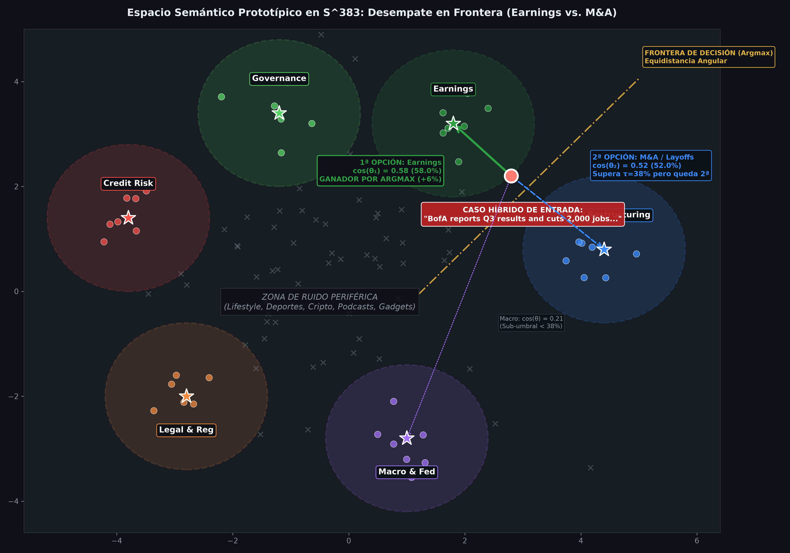

# Categorizador Semántico y Filtro de Ruido (Few-Shot Prototypical Gatekeeper)

Este documento detalla el diseño, la justificación arquitectónica, los fundamentos matemáticos y la validación empírica del **Categorizador Semántico de Artículos Financieros**, implementado en `src/articulos/models/categorizador.py`.

---

## 1. El Problema de Negocio y Técnico

En el lago de datos financiero (Cloudflare R2, capa Bronze) disponemos de un histórico consolidado de **~90.000 noticias** (2010–2023) asociadas a los seis grandes bancos de EE.UU. (*JPMorgan Chase, Bank of America, Wells Fargo, Citigroup, Goldman Sachs y Morgan Stanley*).

Sin embargo, el dato crudo presenta dos graves patologías para el modelado cuantitativo:

1. **Ruido masivo (~70 % de las noticias no son relevantes):** el categorizador actual (v2) descarta **62.629 de 89.846 noticias (69,71 %)** y deja **27.217 útiles (30,29 %)**. La primera versión (v1) descartaba 52.487 (58,42 %), pero dejaba pasar demasiado ruido (ver §5). En los feeds de noticias financieras aparecen con frecuencia artículos de estilo de vida, resúmenes genéricos de Wall Street, resultados de ensayos clínicos o noticias de consumo que mencionan de pasada un ticker sin aportar información del valor del banco.
2. **Coste e ineficiencia de cómputo:** Pasar 90.000 artículos completos por un modelo Transformer pesado como **FinBERT** (longitud de contexto 512 tokens) requeriría cientos de horas de inferencia en CPU y degradaría la señal predictiva al calcular polaridades sobre eventos irrelevantes.

> **Objetivo:** Construir un filtro de alta velocidad (*Gatekeeper*) que opere aguas arriba de FinBERT, descartando el ruido con coste computacional 0,00 € y clasificando los artículos legítimos en 6 dimensiones financieras corporativas (*Earnings, M&A, Legal, Macro, Credit, Governance*).

---

## 2. Benchmark Experimental y Por Qué se Tomó Esta Decisión

En la fase exploratoria nos encontramos en un escenario de **Cold-Start**: no existía un dataset etiquetado manualmente de 90.000 filas para entrenar un clasificador supervisado desde cero. Se evaluó una **matriz experimental 2x2** contrastando arquitecturas y paradigmas de supervisión:

| Paradigma de Supervisión | Arquitectura A: Cross-Encoder NLI (`DistilBERT-MNLI`) | Arquitectura B: Bi-Encoder Embeddings (`all-MiniLM-L6-v2`) |
| :--- | :--- | :--- |
| **1. ZERO-SHOT**<br>*(Solo nombres de categorías abstractas, sin ejemplos previos)* | • **Mecanismo:** Evaluar hipótesis textuales (*"This text is about legal"*).<br>• **Latencia:** ~260–900 ms/doc en CPU.<br>• **Fallo:** **Colapso multiclase** (el 92.6% colapsa en *Legal* por el vocabulario de riesgo financiero omnipresente).<br>• **Veredicto:** ❌ **Descartado** | • **Mecanismo:** Embedding de palabras aisladas (*"Legal"*, *"Earnings"*).<br>• **Latencia:** ~25 ms/doc en CPU.<br>• **Fallo:** **Dispersión angular y ambigüedad** en $\mathbb{S}^{383}$ (solapamiento entre tópicos).<br>• **Veredicto:** ❌ **Descartado** |
| **2. FEW-SHOT**<br>*(Con 4-5 ejemplos canónicos de soporte por categoría)* | • **Mecanismo:** Múltiples hipótesis detalladas o pasajes de soporte en el Cross-Encoder.<br>• **Latencia:** Multiplica el coste de inferencia ($K \times M$), requiriendo >100 horas de CPU.<br>• **Fallo:** Inviabilidad computacional y cuello de botella de escalabilidad.<br>• **Veredicto:** ❌ **Descartado** | • **Mecanismo:** **Redes Prototípicas (Snell et al.)**. Centroides normalizados construidos a partir de 4-5 *exemplars* en $\mathbb{S}^{383}$.<br>• **Latencia:** **~25 ms/doc en CPU** (producto punto $O(N)$ vía BLAS).<br>• **Rendimiento:** **F1-Score 83.1%**, Recall 86.1%, Precisión 80.5%.<br>• **Veredicto:** 🏆 **GANADOR ADOPTADO** |

### ¿Por qué NO usar un LLM comercial (OpenAI / Claude)?
* **Coste de API inasumible:** Procesar 90.000 noticias y re-evaluaciones continuas con APIs de pago supondría cientos de dólares para un proyecto académico con restricción de coste 0,00 €.
* **Latencia y dependencia externa:** Rate limits, cuotas de red y latencias de más de 1-2 segundos por llamada.

### ¿Por qué triunfó el Bi-Encoder Prototípico (`all-MiniLM-L6-v2`)?
* **Redes Prototípicas (Snell et al.):** En lugar de un vector abstracto de una sola palabra, se toman 4 o 5 titulares/noticias reales paradigmáticas de cada categoría y se calcula su centroide en la hipersfera unitaria $\mathbb{S}^{383}$.
* **Inferencia ultrarrápida:** La similitud entre el documento y todas las categorías se reduce a una sola multiplicación matricial $S = E \cdot C^T$ mediante BLAS en memoria RAM (~25 ms por documento en CPU).

---

## 3. Funcionamiento Interno y Cálculo de la Tasa de Confianza

A continuación se ilustra la arquitectura geométrica del modelo y el procedimiento de inferencia que determina si una noticia se admite como señal financiera o se descarta como ruido:



> [!WARNING]
> **Esquema ilustrativo, no una medición.** Las posiciones de los puntos en el gráfico y los valores de coseno de los ejemplos (0,58, 0,52, 0,21, 0,68, 0,29) están elegidos a mano para explicar el mecanismo. **No** son una proyección real (PCA/t-SNE) de los embeddings de `all-MiniLM-L6-v2` ni salidas reales del modelo. Los titulares de ejemplo tampoco proceden del corpus. Las cifras de rendimiento reales están únicamente en la sección 5.

---

### A. Elementos Clave del Espacio Semántico

* **Los 6 Clusters Financieros:** Cada categoría empresarial canónica (*Earnings, M&A, Macro, Legal, Credit, Governance*) está representada por una estrella que simboliza su **centroide prototípico** $\vec{c}_k \in \mathbb{S}^{383}$, rodeado por sus ejemplos de entrenamiento (*exemplars*).
* **El Radio de Aceptación ($\tau = 0.38$):** El círculo punteado marca la frontera del umbral de decisión. Cualquier artículo proyectado dentro del radio posee afinidad angular suficiente para considerarse relevante.
* **La Nube Periférica de Ruido (~70 % del corpus en la v2):** Puntos grises en forma de aspa que representan artículos fuera de dominio (*lifestyle, deportes, podcasts, tecnología, resúmenes diarios de bolsa*). Caen alejados de los centroides y se purgan automáticamente sin llegar a FinBERT.
* **Línea Amarilla (Frontera de Decisión / Voronoi Boundary):** Divide la región geométrica equidistante entre dos centroides contiguos. Determina matemáticamente qué categoría gana cuando un texto se encuentra en zona de solapamiento.

---

### B. El Caso Crítico de Frontera: ¿Por qué una Noticia Híbrida cae en *Earnings* y no en *M&A*?

En la prensa económica existen artículos que mencionan simultáneamente resultados trimestrales y recortes de plantilla o reestructuración empresarial:
> **Artículo de Entrada (Punto Rojo):**  
> *"Bank of America reports Q3 results, cuts 2,000 jobs in wealth management restructuring and books merger advisory fees."*

Al calcular las similitudes respecto a todos los centroides:
1. **Similitud con *Earnings*:** $\cos(\theta_1) = 0.58 \implies \mathbf{58.0\%}$ (Supera el umbral $\tau = 38\%$).
2. **Similitud con *M&A / Reestructuración*:** $\cos(\theta_2) = 0.52 \implies \mathbf{52.0\%}$ (Supera el umbral $\tau = 38\%$).
3. **Similitud con *Macro*:** $\cos(\theta_3) = 0.21 \implies \mathbf{21.0\%}$ (Sub-umbral, descartada).

> [!IMPORTANT]
> **¿Por qué se clasifica de forma determinista como *Earnings*?**  
> Ambas categorías superan el umbral mínimo de corte ($\tau = 38\%$). Sin embargo, el clasificador no recurre a heurísticas arbitrarias ni a reglas *if-else* frágiles: aplica la regla matemática del **Argmax** sobre el producto escalar en la hipersfera $\mathbb{S}^{383}$:
> $$k^* = \arg\max_{k} \langle \vec{e}_{\text{doc}}, \vec{c}_k \rangle = \arg\max(0.58, 0.52, 0.21, \dots) \implies \mathbf{"Earnings"}$$
> Como el ángulo hacia *Earnings* es menor ($\theta_1 \approx 54.5^\circ$ frente a $\theta_2 \approx 58.7^\circ$), la densidad semántica de la noticia gravita hacia los resultados financieros. La noticia se asigna a *Earnings* con un margen de victoria del **+6.0%**.

---

### C. Procedimiento Matemático de Inferencia y Decisión

| Etapa | Operación Matemática | Descripción y Ejemplo Práctico |
| :--- | :--- | :--- |
| **1. Extracción & Fusión** | $\vec{e}_{\text{doc}} = \frac{0.65 \vec{e}_t + 0.35 \vec{e}_c}{\|0.65 \vec{e}_t + 0.35 \vec{e}_c\|_2}$ | Se combinan el **Titular** ($\vec{e}_t$, 65% de peso) y el **Fragmento contextual del banco** ($\vec{e}_c$, 35% de peso) para resolver el *Buried Lead*. El vector resultante se normaliza en la hipersfera $\mathbb{S}^{383}$. |
| **2. Similitud Matricial** | $S = C \cdot \vec{e}_{\text{doc}}$ | Multiplicación $O(N)$ en memoria contra la matriz de 7 centroides $C \in \mathbb{R}^{7 \times 384}$. Devuelve el vector de cosenos directos: $S = [\cos(\theta_1), \dots, \cos(\theta_7)]$. |
| **3. Tasa de Confianza** | $\text{Confianza} = \cos(\theta_{\text{máx}}) \times 100$ | Al estar normalizados los vectores, el producto punto es el coseno del ángulo. En el caso híbrido: $\cos(\theta_{\text{máx}}) = 0.580 \implies \mathbf{58.0\%}$ (categoría ganadora: *Earnings*). |
| **4. Regla de Decisión** | $\text{Confianza} \ge \tau$ | Si no hay rol de analista sobre un tercero y la confianza supera el umbral adaptativo ($\tau = 38\%$ para mención prominente), se emite **SEÑAL VÁLIDA** para FinBERT. De lo contrario, se marca como **RUIDO**. |

> [!NOTE]
> **Ventaja de Rendimiento (KISS & DRY):**
> Al precalcular y congelar los centroides normalizados en la inicialización de la clase, clasificar un lote de noticias no requiere búsquedas iterativas ni llamadas a modelos generativos: se resuelve mediante álgebra lineal matricial pura en CPU en aproximadamente **25 milisegundos por documento**.

---

## 4. Innovaciones Clave y Reglas de Dominio Financiero

El código no se limita a calcular un coseno vectorial; incorpora soluciones a seis problemas de la prensa financiera (apartados A a F):

### A. Resolución del *Buried Lead* (Titular vs. Párrafo Oculto)

En periodismo financiero (Reuters, Bloomberg, Dow Jones), el titular suele ser un resumen global, pero el detalle sobre el banco objetivo (ej. JPMorgan) está "enterrado" en el tercer o cuarto párrafo.

* **Solución (`extraer_fragmento_y_presencia`):** El algoritmo busca el párrafo específico donde se nombra al banco, ignora el *boilerplate* genérico del sector (*"X is part of the financial sector..."*) y extrae una ventana de 400 caracteres.
* **Fusión adaptativa ponderada:**

```math
\vec{e}_{\text{doc}} = \frac{0.65 \cdot \vec{e}_{\text{titular}} + 0.35 \cdot \vec{e}_{\text{fragmento}}}{\|0.65 \cdot \vec{e}_{\text{titular}} + 0.35 \cdot \vec{e}_{\text{fragmento}}\|_2}
```

Esto garantiza que el 65% del peso mantenga el tópico general de la noticia mientras el 35% aporta el contexto específico de la entidad.

---

### B. Mitigación de Falsos Positivos de Tickers (`\b` Regex)
Tickers de dos letras como **GS** (*Goldman Sachs*) o **MS** (*Morgan Stanley*) colisionan frecuentemente si se buscan como subcadenas simples:
* `"gs"` coincide dentro de: *earnin**gs***, *holdin**gs***, *thin**gs***.
* `"ms"` coincide dentro de: *ter**ms***, *fir**ms***, *progra**ms***.
* **Solución (`contiene_alias`):** Se exige frontera de palabra regex obligatoria: `\bGS\b` y `\bMS\b`.

### C. Desambiguación del Rol de Analista (`es_rol_analista_tercero`)
Con mucha frecuencia, un banco de inversión aparece en las noticias no porque le ocurra algo a su negocio, sino porque su departamento de análisis ha emitido una recomendación sobre un tercero (ej: *"Goldman Sachs sube el precio objetivo de Apple"*).
* Si ese artículo se procesara para Goldman Sachs, falsearía el sentimiento de sus propias acciones.
* **Solución:** Se analizan patrones sintácticos (*"note to clients"*, *"upgrades"*, *"downgrades"*, *"reiterated buy"*, y listas ampliadas de términos de analista en `shared/tickets.py`). Si el banco es sujeto opinando sobre un tercero, el categorizador lo clasifica como **Ruido** para el ticker del banco.
* **Limitación conocida:** la auditoría de la v2 detectó que reglas de este tipo aplicadas como *post-filtro* sobre el fragmento actual pueden descartar noticias legítimas en las que el banco bate estimaciones de analistas o recibe un *upgrade* (ver §5.3).

### D. Umbrales Adaptativos y Reglas de Anclaje (`evaluar_es_ruido`)
En lugar de un umbral fijo e insensible, el filtro aplica **descartes duros** y después **umbrales dinámicos** ($\tau$) sobre la confianza de la categoría ganadora. Orden de evaluación en el código actual:

| Paso | Regla | Resultado |
| :-: | :--- | :--- |
| 1 | Rol de analista sobre un tercero (§C), contaminación por banco competidor (§E), plantilla irrelevante (§F) o categoría ganadora `ruido` | **Ruido** (descarte directo) |
| 2 | Umbral $\tau$ según el contexto (ver tabla inferior): si `confianza < τ` | **Ruido** |
| 3 | Anclaje: si la categoría **no** es macro y el banco **no** es prominente (ni en titular ni en el fragmento) | **Ruido** |
| 4 | Si la categoría es macro, el banco no es prominente y el texto no tiene impacto bancario sistémico | **Ruido** |
| 5 | Titular sin cuerpo en el que el banco no aparece en el titular y no hay impacto macro sistémico | **Ruido** |
| 6 | Ninguna de las anteriores | **Señal** (pasa a FinBERT) |

Umbral $\tau$ del paso 2:

| Caso | $\tau$ |
| :--- | :---: |
| Artículo con cuerpo, banco prominente o contexto macro | 0,38 |
| Artículo con cuerpo, mención secundaria | 0,48 |
| Titular sin cuerpo, banco en titular o contexto macro | 0,30 |
| Titular sin cuerpo, resto de casos | 0,38 |

> [!NOTE]
> La versión anterior de este documento incluía una regla de "rescate de cables monoticker" ($\tau \ge 0{,}35$). **Ya no existe en el código actual**: la sustituyen las reglas de anclaje de los pasos 3 a 5.

### E. Contaminación por Banco Competidor (`es_contaminacion_competidor`)
Un mismo texto aparece asociado a varios bancos (*cross-bank bleed*). Si el **titular** habla de otro banco del Big 6 y no del banco asignado, la fila se descarta, salvo que: el titular nombre al banco asignado, hable de forma genérica del sector (*"banks", "peers", "rivals", "Wall Street", "banking sector"*) o el banco asignado aparezca en el cuerpo.

### F. Plantillas Irrelevantes (`es_plantilla_irrelevante`)
Descarta notas robotizadas sin información del banco: declaraciones patrimoniales de fondos (patrones **13F**, "% of the total portfolio") y titulares tipo lista multi-ticker sin cuerpo.

---

## 5. Validación Empírica y Resultados

> [!IMPORTANT]
> Hay **dos mediciones distintas** y no son comparables entre sí. La auditoría de la v2 (§5.2) es la más reciente y describe el clasificador actual. La validación de §5.1 procede del ADR-005 y **no se ha podido confirmar sobre qué versión del clasificador se calculó**; se conserva como referencia histórica hasta repetirla sobre la v2.

### 5.1. Validación inicial documentada en ADR-005 (306 artículos, 3 semillas)

| Métrica de Calidad | Semilla 1 (Benchmark) | Semilla 2 (Out-of-Sample) | Semilla 3 (Out-of-Sample) | Promedio Global |
| :--- | :---: | :---: | :---: | :---: |
| **Artículos Evaluados** | 102 | 102 | 102 | **306** |
| **Pasan a FinBERT (Señal)** | 52.0% | 52.9% | 51.0% | **51.9%** |
| **Ruido Descartado** | 48.0% | 47.1% | 49.0% | **48.1%** |
| **Recall (Sensibilidad)** | 81.0% | 89.8% | 87.5% | **86.1%** |
| **Precisión** | 79.1% | 81.5% | 80.8% | **80.5%** |
| **F1-Score** | **80.0%** | **85.4%** | **84.0%** | **83.1%** |

> Nota: la muestra de 306 artículos está equilibrada a propósito (≈ 50 % señal), por lo que el porcentaje de ruido de la muestra no equivale al del corpus completo.

### 5.2. Auditoría de la v2 sobre el corpus completo (`df_util_v2`, N = 89.846)

Fuente: `src/notebooks/FP_origen_auditoria_zero_shot.md` y notebooks `zero_shot_clasiffication_*`.

| Indicador | v1 | v2 (actual) |
| :--- | :---: | :---: |
| Noticias útiles (`is_ruido = False`) | 37.359 (41,58 %) | **27.217 (30,29 %)** |
| Noticias descartadas como ruido | 52.487 (58,42 %) | **62.629 (69,71 %)** |
| Útiles sin el banco en titular ni en fragmento | 19,95 % (7.453) | **2,02 % (550)** |
| Precisión en muestra manual (N = 30 útiles) | 60,0 % | **80,0 % – 83,3 %** |
| Valor predictivo negativo (N = 30 descartadas) | 83,3 % | **86,7 % – 93,3 %** |
| Exactitud global (N = 60) | 71,7 % | **85,0 % – 88,3 %** |

Los rangos reflejan dos criterios de revisión (estricto y laxo). Las muestras son pequeñas (30 + 30 noticias), así que **las cifras de la v2 son indicativas, no definitivas**.

### 5.3. Hallazgos y limitaciones de la v2
* **Falsos negativos:** en la muestra de 30 noticias descartadas, 2 eran útiles reales (≈ 6,7 %). Uno de ellos era un evento crítico (pérdida trimestral de Wells Fargo) descartado porque el titular era genérico y su confianza (35,99 %) no superó el umbral.
* **Pureza tras limpieza:** sobre el "núcleo limpio" (25.551 noticias, 93,88 %), una muestra de 30 dio 29 verdaderos positivos (96,7 %).
* **Atribución de entidad:** en titulares sin cuerpo con varios tickers, el sujeto real puede ser otro banco (contaminación cruzada residual).
* **Post-filtros antiguos:** las cubetas `FP_3` (otro banco en titular) y `FP_4` (banco como analista) **no deben aplicarse** sobre el `process_text` de la v2: destruirían más de 1.200 noticias verdaderas.
* **Pendiente:** repetir la validación de 306 artículos sobre la v2 para obtener recall, precisión y F1 comparables y calcular una tasa de falsos negativos con muestra suficiente.

---

## 6. Referencias y Fuentes Bibliográficas

### A. Implementación en el Proyecto
* **Código Fuente Principal:** [`src/articulos/models/categorizador.py`](../../articulos/models/categorizador.py)
* **Job de Procesamiento en Lotes (ETL):** [`src/articulos/etl_categorizacion.py`](../../articulos/etl_categorizacion.py)
* **Banco de Pruebas Unitarias:** [`src/test/test_categorizador.py`](../../test/test_categorizador.py) y [`src/test/test_etl_categorizacion.py`](../../test/test_etl_categorizacion.py)
* **Diccionarios de Categorías y Alias:** [`src/articulos/categories.py`](../../articulos/categories.py) y [`src/shared/tickets.py`](../../shared/tickets.py)
* **Auditoría de la v2 (falsos positivos y negativos):** [`src/notebooks/FP_origen_auditoria_zero_shot.md`](../../notebooks/FP_origen_auditoria_zero_shot.md)

### B. Fundamentos Teóricos y Fuentes de Aprendizaje
* **Tutorial de Clasificación Zero-Shot (DataCamp):**  
  [DataCamp — Clasificación Zero-Shot en Español](https://www.datacamp.com/es/tutorial/zero-shot-classification)  
  *Explica cómo evaluar textos sin datos de entrenamiento mediante modelos de lenguaje y formulación de hipótesis.*
* **Conceptos de Aprendizaje Zero-Shot & Few-Shot (IBM Think):**  
  [IBM Think — ¿Qué es el aprendizaje zero-shot?](https://www.ibm.com/es-es/think/topics/zero-shot-learning)  
  *Guía sobre la transferencia de conocimiento semántico hacia categorías no vistas previamente.*
* **Modelo Bi-Encoder `all-MiniLM-L6-v2` (Hugging Face Hub):**  
  [Hugging Face — sentence-transformers/all-MiniLM-L6-v2](https://huggingface.co/sentence-transformers/all-MiniLM-L6-v2)  
  *Ficha técnica del modelo de 384 dimensiones optimizado para similitud coseno y búsqueda semántica de baja latencia.*
* **Framework Sentence-Transformers & Similitud Coseno:**  
  [SBERT.net — Semantic Search & Cosine Similarity](https://www.sbert.net/examples/applications/semantic-search/README.html)  
  *Documentación oficial sobre el cálculo de producto escalar entre vectores normalizados para recuperación semántica.*
* **Publicación Base sobre Redes Prototípicas:**  
  Snell, J., Swersky, K., & Zemel, R. (2017). *Prototypical Networks for Few-shot Learning*. Advances in Neural Information Processing Systems (NeurIPS 2017).  
  [arXiv:1703.05175](https://arxiv.org/abs/1703.05175)  
  *Artículo seminal que define la representación de clases mediante la media de ejemplos de soporte en un espacio métrico.*
