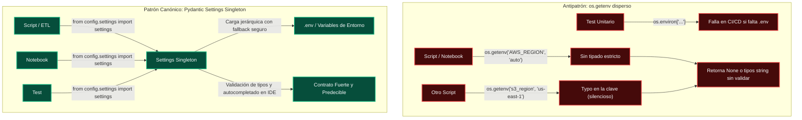

# Módulo de Configuración (`src/config/`)

Este paquete centraliza la carga, validación tipada y gestión de variables de entorno para todo el proyecto **TFM-Master** mediante el singleton `settings` basado en **Pydantic Settings** (`BaseSettings`).

---

## 🎯 ¿Por qué usar `settings` en lugar de `os.getenv`?

El uso directo de `os.getenv` o `os.environ` disperso en scripts y notebooks es un **antipatrón** común que introduce fragilidad técnica e inconsistencias en proyectos colaborativos:



### Tabla Comparativa de Ventajas

| Característica | `os.getenv("VARIABLE")` ❌ | `settings.variable` ✅ |
| :--- | :--- | :--- |
| **Validación de tipos** | Ninguna (devuelve siempre `str` o `None`). | **Estricta** vía Pydantic (enteros, booleanos, URLs, etc.). |
| **Valores por defecto** | Inconsistentes (cada archivo inventa su propio fallback). | **Centralizados** en una única clase de verdad. |
| **Detección de errores** | Silenciosa en tiempo de ejecución (`AttributeError: 'NoneType'`). | **Inmediata al arrancar** (`ValidationError`). |
| **Autocompletado IDE** | Nulo (cadena de texto mágica sin IntelliSense). | **Total** (tu editor sugiere `settings.s3_bucket_name`). |
| **Resolución de ruta `.env`**| Depende del directorio actual (`cwd`) donde se ejecute. | **Absoluta** (resuelve desde la raíz del proyecto sin importar desde dónde se invoque). |
| **Inmutabilidad y tests** | Variables mutables globales difíciles de aislar. | Se puede sobreescribir limpiamente en mocks con `patch`. |

---

## 🛠️ Catálogo de Variables Disponibles

El archivo `settings.py` expone los siguientes atributos con tipado fuerte:

### 1. Almacenamiento S3 / Cloudflare R2
* `settings.aws_access_key_id`: Token / Access Key de Cloudflare R2 o AWS.
* `settings.aws_secret_access_key`: Secret Key de Cloudflare R2 o AWS.
* `settings.s3_endpoint_url`: URL del endpoint S3 (ej. `https://<account_id>.eu.r2.cloudflarestorage.com` o `http://localhost:9000`).
* `settings.s3_bucket_name`: Bucket analítico de destino del TFM (ej. `tfm-master-prediccion-bancos-usa`).
* `settings.s3_prefix_raw_data`: Prefijo base para la capa cruda del Data Lake (por defecto `"raw-data"`).
* `settings.s3_region`: Región S3 configurada (por defecto `"us-east-1"` o `"auto"` para Cloudflare R2).

### 2. Scraping Distribuido (`WebScrapingDistributed`)
* `settings.scraper_api_url`: URL base de la API Producer (ej. `https://webscraping-distributed.duckdns.org`).
* `settings.scraper_basic_auth_user`: Usuario HTTP Basic Auth para el proxy inverso.
* `settings.scraper_basic_auth_password`: Contraseña HTTP Basic Auth.

---

## 💻 Guía de Uso Rápido

### En cualquier script, ETL o módulo (`.py`):
```python
from config.settings import settings

# Acceso directo y seguro con autocompletado en el IDE
print(f"Conectando al bucket: {settings.s3_bucket_name}")
print(f"Endpoint: {settings.s3_endpoint_url}")
```

### En Notebooks de Jupyter (`.ipynb`):
Al inicio del notebook, aseguramos que la ruta hacia `src/` esté en `sys.path` antes de importar:
```python
import sys
from pathlib import Path

CURRENT_DIR = Path.cwd().resolve()
SRC_PATH = str(CURRENT_DIR.parent) if CURRENT_DIR.name == "notebooks" else str(CURRENT_DIR / "src")
if SRC_PATH not in sys.path:
    sys.path.insert(0, SRC_PATH)

from config.settings import settings

print("Configuración cargada:", settings.s3_bucket_name)
```

---

## 📝 Cómo añadir una nueva variable al proyecto

Si necesitas incorporar una nueva variable de configuración:

1. **Abre `src/config/settings.py`**:
   Añade el atributo con su tipo y un valor por defecto sensato para desarrollo local o tests:
   ```python
   class Settings(BaseSettings):
       ...
       nueva_api_token: str = "token_de_prueba"
   ```
2. **Añade la variable al archivo `.env.template`**:
   ```env
   NUEVA_API_TOKEN=tu_token_aqui
   ```
3. **Úsala en tu código**:
   ```python
   from config.settings import settings
   token = settings.nueva_api_token
   ```
