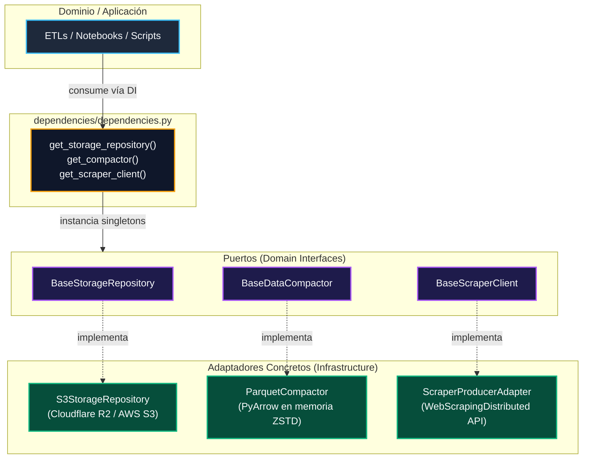

# Capa de Infraestructura (`src/infrastructure/`)

Este paquete implementa los adaptadores técnicos y servicios de infraestructura del proyecto bajo los principios de **Clean Architecture** (Arquitectura Hexagonal).

Su propósito es desacoplar completamente la lógica de negocio (ETLs, NLP, entrenamiento de modelos) de los detalles tecnológicos externos como APIs HTTP, clientes de almacenamiento en la nube o bibliotecas de compresión.

---

## 🏛️ Arquitectura y Principio de Inversión de Dependencias (DIP)

Todos los módulos siguen el patrón de interfaces abstractas (**Puertos**) y clases concretas (**Adaptadores**), consumidos a través de la fábrica centralizada de dependencias en `dependencies.py`:



---

## 📦 Componentes y Guía de Uso Rápido

### 1. Almacenamiento en Nube: `storage/` (Cloudflare R2 / AWS S3)

Proporciona operaciones idempotentes y asíncronas para leer y persistir archivos en el Data Lake sin exponer credenciales ni configurar clientes de AWS manualmente.

* **Puerto (Contrato)**: `infrastructure.storage.base.BaseStorageRepository`
* **Adaptador Concreto**: `infrastructure.storage.s3.adapter.S3StorageRepository`
* **Método de obtención recomendado**: `dependencies.get_storage_repository()`

#### 🚀 Cómo usarlo en scripts o ETLs:

```python
import asyncio
from dependencies.dependencies import get_storage_repository

# 1. Obtener la instancia singleton inyectada
storage = get_storage_repository()

# --- Guardar un archivo en R2 ---
payload_bytes = b"contenido binario o parquet"
asyncio.run(storage.save(key="raw/mi_carpeta/dataset.parquet", body=payload_bytes))

# --- Leer un archivo de R2 ---
data_bytes = asyncio.run(storage.get("raw/mi_carpeta/dataset.parquet"))

# --- Listar claves por prefijo ---
keys = asyncio.run(storage.list_keys(prefix="raw/sec/"))
print(f"Archivos encontrados: {len(keys)}")
```

#### 📓 Cómo usarlo en Notebooks (Jupyter):
En notebooks con Pandas, para cargar un DataFrame directamente en memoria sin archivos temporales:

```python
import io
import asyncio
import pandas as pd
from dependencies.dependencies import get_storage_repository

storage = get_storage_repository()
data = asyncio.run(storage.get("raw/yfinance/stocks_2010_2023.parquet"))
df = pd.read_parquet(io.BytesIO(data))
display(df.head())
```

---

### 2. Compactación y Serialización: `compaction/` (Apache Parquet en Memoria)

Optimiza la persistencia tabular y mitiga el problema de archivos pequeños (*Small Files Problem*) transformando diccionarios o listas en binarios **Parquet** con compresión columnar **ZSTD**.

* **Puerto (Contrato)**: `infrastructure.compaction.base.BaseDataCompactor`
* **Adaptador Concreto**: `infrastructure.compaction.parquet.ParquetCompactor`
* **Método de obtención recomendado**: `dependencies.get_compactor()`

#### 🚀 Cómo usarlo:

```python
from dependencies.dependencies import get_compactor

compactor = get_compactor()

# Datos de entrada (lista de diccionarios, DataFrame o modelos Pydantic)
registros = [
    {"ticker": "JPM", "precio": 145.20, "fecha": "2023-01-10"},
    {"ticker": "BAC", "precio": 32.50, "fecha": "2023-01-10"},
]

# 1. Compactar en memoria a bytes Parquet (ZSTD por defecto)
parquet_bytes = compactor.compact(registros)

# 2. Descompactar a diccionarios originales
filas_recuperadas = compactor.decompact(parquet_bytes)
assert len(filas_recuperadas) == 2
```

---

### 3. Cliente de Scraping Distribuido: `scraper/`

Gestiona el envío masivo y concurrente de tareas de extracción web hacia el clúster de scraping distribuido (`WebScrapingDistributed`), incorporando particionado en lotes (*batching*), autenticación HTTP Basic y reintentos automáticos con backoff exponencial.

* **Puerto (Contrato)**: `infrastructure.scraper.base.BaseScraperClient`
* **Modelo de Tarea**: `infrastructure.scraper.base.ScraperTask`
* **Adaptador Concreto**: `infrastructure.scraper.producer_adapter.ScraperProducerAdapter`
* **Método de obtención recomendado**: `dependencies.get_scraper_client()`

#### 🚀 Cómo usarlo:

```python
import asyncio
from infrastructure.scraper.base import ScraperTask
from dependencies.dependencies import get_scraper_client

scraper = get_scraper_client()

# 1. Definir las tareas de scraping
tareas = [
    ScraperTask(
        url="https://www.sec.gov/edgar/data/19617/000001961723000001/doc.htm",
        parser_type="static_css",  # "static_css" o "dynamic_playwright"
        selectors={"titulo": "h1", "cuerpo": "div.document"},
        priority=5,
        context={"ticker": "JPM", "filing_type": "8-K"},
    )
]

# 2. Despachar en lotes asíncronos con trazabilidad (job_id)
async def enviar():
    resultado = await scraper.dispatch_tasks(
        job_id="job_sec_8k_2023",
        tasks=tareas,
        batch_size=50,
        global_context={"modulo": "sec_discovery"}
    )
    print("Resumen de envío:", resultado)

asyncio.run(enviar())
```

---

## ⚠️ Reglas y Buenas Prácticas para el Equipo

1. **Nunca instanciar `boto3.client("s3")` a mano**: Utilizar siempre `get_storage_repository()`. Esto garantiza que los endpoints de Cloudflare R2, las credenciales seguras y el pool de conexiones asíncrono se reutilicen eficientemente.
2. **Respetar prefijos del Data Lake**: Guardar las claves bajo los directorios canónicos definidos en la arquitectura (`raw/`, `processed/`, `curated/`).
3. **Compresión estándar**: Usar siempre **ZSTD** para archivos Parquet analíticos.
4. **Mocking en Tests**: Al escribir pruebas para funciones que utilicen almacenamiento o compactador, inyectar `unittest.mock.AsyncMock` o `MagicMock` sobre las interfaces base sin conectar a la red real.
