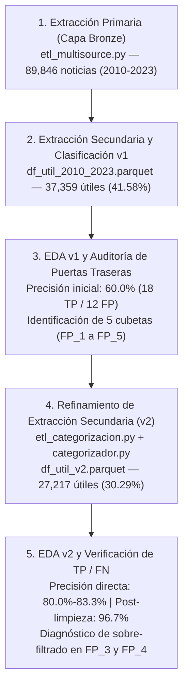

# 📋 Memoria Técnica de Auditoría: Extracción Primaria, Extracción Secundaria y Evolución de Calidad Zero-Shot (v1 vs. v2, 2010–2023)

**Universo de estudio:** US Big 6 (`BAC`, `C`, `GS`, `JPM`, `MS`, `WFC`)  
**Horizonte temporal:** `2010–2023` (**89,846 registros tras unificación Bronze**)  
**Archivos en Cloudflare R2 (`tfm-master-prediccion-bancos-usa`):**
* **Capa Silver completa:** `processed/huggingface/multisource_bancos_2010_2023.parquet` (`89,846` filas)
* **Subconjunto útil v1 (Iteración inicial):** `processed/huggingface/df_util/df_util_2010_2023.parquet` (`37,359` filas útiles, `41.58%`)
* **Subconjunto útil v2 (Iteración refinada actual):** `processed/huggingface/df_util/df_util_v2.parquet` (`27,217` filas útiles, `30.29%`)

---

## 0. Hoja de Ruta y Arquitectura Evolutiva del Pipeline

Para garantizar que el modelo de análisis de sentimiento financiero (**FinBERT**) reciba exclusivamente señal corporativa o sectorial legítima de cada banco y no ruido exógeno, el procesamiento de noticias se estructuró en **cinco fases secuenciales**:

| Etapa del Proyecto | Script / Notebook Asociado | Objetivo Principal | Resultado Clave |
| :--- | :--- | :--- | :--- |
| **1. Extracción Primaria (Bronze)** | `src/articulos/etl_multisource.py` `huggingface_2010_2023_EDA_v2.ipynb` | Unificar datasets de HuggingFace (FNSPID + Philipp), filtrar por el *US Big 6* (`2010–2023`), deduplicar y marcar artículos multi-sujeto (`ticker_count`). | **89,846 noticias** consolidadas sin huecos anuales, pero con alta contaminación cruzada (*ticker bleed*) y titulares sin cuerpo (`25.6%`). |
| **2. Extracción Secundaria y Categorización v1** | `src/articulos/etl_categorizacion.py` *(v1)* `df_util_2010_2023.parquet` | Extraer la ventana de contexto (`process_text`) alrededor del banco y clasificar con `all-MiniLM-L6-v2` en 6 categorías financieras vs. `ruido`. | Retuvo **37,359 noticias útiles (`41.58%`)** y descartó **52,487 (`58.42%`)**. |
| **3. EDA v1 y Diagnóstico de Falsos Positivos** | `zero_shot_clasiffication_eda.ipynb` `zero_shot_clasiffication_FP_Analisis.ipynb` | Auditar muestras estratificadas ($N=60$) y cuantificar programáticamente por qué se colaban falsos positivos en `is_ruido == False`. | Precisión muestral de solo **`60.0%` (`18 TP / 12 FP`)**. Se aislaron **5 puertas traseras (`FP_1` a `FP_5`)** que sumaban **6,225 FP (`16.66%`)**. |
| **4. Extracción Secundaria Refinada (v2)** | `src/articulos/etl_categorizacion.py` *(v2)* `src/articulos/models/categorizador.py` `df_util_v2.parquet` | Corregir en origen el extractor de fragmentos (`process_text`) y endurecer las reglas de saliencia de entidad, rol de analista y salvoconducto macro. | Redujo el corpus útil a **27,217 noticias (`30.29%`)**, depurando de raíz **10,142 registros ruidosos** antes de salir del pipeline ETL. |
| **5. EDA v2 y Verificación de Pureza (`TP` y `FN`)** | `zero_shot_clasiffication_eda copy.ipynb` `zero_shot_clasiffication_FP_Analisis copy.ipynb` | Repetir el EDA y el análisis de cubetas sobre `df_util_v2.parquet` para verificar la ganancia en precisión y auditar posibles Falsos Negativos (`FN`). | La precisión directa sube al **`80.0%–83.3%`** (`25 TP / 5 FP`) y los errores `FP_1 + FP_2` caen un **`98.3%`** (de `4,195` a solo `71` casos). |

---

## 1. Fase 1: Extracción Primaria (Capa Bronze) y Naturaleza del Ruido de Origen

En la **Extracción Primaria** (`src/articulos/etl_multisource.py`), el objetivo fue construir un corpus histórico completo (`2010–2023`) combinando las particiones crudas de HuggingFace para los 6 grandes bancos estadounidenses (`BAC`, `C`, `GS`, `JPM`, `MS`, `WFC`).

Durante el EDA de la capa Bronze (`huggingface_2010_2023_EDA_v2.ipynb`) se detectaron **tres patologías estructurales propias de los agregadores financieros** que obligaron a diseñar una segunda fase de extracción semántica:

1. **Contaminación Multi-Ticker (*Ticker Bleed*):** Un mismo artículo de mercado (p. ej. un resumen del S&P 500 o una nota sobre *Apple* o *Nvidia*) aparece replicado bajo el `ticker` de un banco simplemente porque la plataforma de origen etiquetó todas las acciones mencionadas al pie de la página o porque un analista del banco emitió un comentario sobre esa tercera empresa. Se crearon las variables `ticker_count` e `is_multisubject` (`ticker_count > 1`) para penalizar estos casos.
2. **Noticias Huérfanas de Cuerpo (`23,010` registros, `25.61%` del total de `89,846`):** Más de una cuarta parte del corpus carece de cuerpo (`article` vacío o redundante con el titular), siendo marcada en el preprocesamiento con la etiqueta `(Titular directo sin cuerpo)`.
   * De esas `23,010` noticias sin cuerpo, solo **`9,211` (`10.25%`)** mencionan realmente al banco en el titular (titulares *flash* legítimos de agencias como Reuters o Benzinga).
   * Las restantes **`13,799` (`15.36%`)** no mencionan al banco ni en el titular ni tienen cuerpo (*huérfanas totales*).
3. **Artículos Extensos Multi-Tópico:** En crónicas largas donde se habla de 10 o 15 empresas, pasar el texto completo a FinBERT diluía el sentimiento específico del banco. Por ello se implementó en `categorizador.py` una **Extracción Secundaria de Contexto (`process_text`)** capaz de recortar únicamente las oraciones centradas en los alias oficiales del banco (`ALIAS_BANCOS`).

---

## 2. Fase 2 y 3: Categorización Semántica v1, EDA v1 y Diagnóstico de las 5 "Puertas Traseras"

En la **primera iteración del clasificador Zero-Shot (v1)** (`df_util_2010_2023.parquet`), el pipeline filtró las `89,846` noticias dejando **`37,359` noticias útiles (`41.58%`)** y **`52,487` de ruido (`58.42%`)**.

### 2.1. Matriz de Auditoría Cualitativa en EDA v1 ($N = 60$, `df_util_2010_2023.parquet`)

Al auditar manualmente una muestra estratificada (`random_state=42`) de **30 noticias útiles (`is_ruido == False`)** y **30 noticias de ruido (`is_ruido == True`)** en [`zero_shot_clasiffication_eda.ipynb`](file:///C:/Users/felip/OneDrive/Felipe/Master/TFM/TFM-Master/src/notebooks/zero_shot_clasiffication_eda.ipynb), se observó que el descarte era muy limpio (`NPV = 83.3%`), pero **la clase útil sufría una infiltración del `40.0%` de Falsos Positivos (`PPV = 60.0%`)**:

| Predicción del Clasificador v1 \ Realidad Manual | Real: Útil (Señal del Banco) | Real: Ruido (Terceros / Sin Contexto) | Total Muestra | Métrica Muestral v1 |
| :--- | :---: | :---: | :---: | :---: |
| **Predicho v1: SÍ Sirve (`is_ruido == False`)** | **TP = 18** | **FP = 12** | **30** (5 por banco) | **Precisión (PPV):** `60.0%` |
| **Predicho v1: Ruido (`is_ruido == True`)** | **FN = 5** | **TN = 25** | **30** (5 por banco) | **Valor Predictivo Negativo (NPV):** `83.3%` |
| **Total Real** | **23** | **37** | **60** | **Exactitud Global (Accuracy):** `71.7%` |

### 2.2. Las 5 Puertas Traseras Detectadas en v1 (`zero_shot_clasiffication_FP_Analisis.ipynb`)

Al analizar por qué se habían colado esos **12 Falsos Positivos** en la muestra v1 y medir su peso sobre las **37,359 noticias útiles** de `df_util_2010_2023.parquet`, se descubrieron **5 puertas traseras exactas** que sumaban **6,225 Falsos Positivos (`16.66%` del total útil v1)**:

1. **`FP_1: Huérfana Sin Cuerpo ni Banco` (`2,165` noticias en v1 — `5.80%`):**
   * *Causa en v1:* Existía una excepción para registros con `ticker_count == 1` que permitía aprobar noticias con `(Titular directo sin cuerpo)` aunque el titular no mencionara al banco (ej. *"Citi: Moody's Raises Outlook"* asignada a `BAC`, o *"Markets Reserve Judgement on Mixed Jobs Numbers"* asignada a `GS`).
2. **`FP_2: Fallback Con Cuerpo pero Sin Banco` (`2,030` noticias en v1 — `5.43%`):**
   * *Causa en v1:* Cuando el extractor secundario no encontraba al banco en ningún párrafo del cuerpo, hacía un *fallback* tomando los primeros 400 caracteres del artículo; si allí aparecía una palabra macro general (`economy`, `treasury`, `inflation`), el "salvoconducto macro" aprobaba la noticia aunque el banco no existiera en todo el texto.
3. **`FP_3: Otro Banco en Titular / Cross-Bank Bleed` (`786` noticias en v1 — `2.10%`):**
   * *Causa en v1:* Titulares protagonizados en exclusiva por otro banco competidor (ej. *"Citigroup Warns Bond Traders..."* en una fila de `JPM`) procedentes de boletines con titulares concatenados.
4. **`FP_4: Banco como Casa de Análisis / Pronóstico Macro` (`980` noticias en v1 — `2.62%`):**
   * *Causa en v1:* Artículos sobre terceras empresas (*Snap*, *Apple*, *Intel*) donde el banco solo emitía una recomendación (`"downgrade from Morgan Stanley"`) o un pronóstico macro de casa de estudios (`"Goldman cuts forecast for U.S. economic growth"`).
5. **`FP_5: Plantillas Robotizadas 13F / ETF / Listas TV` (`264` noticias en v1 — `0.71%`):**
   * *Causa en v1:* Notas generadas automáticamente sobre carteras de fondos pequeños (`"% of the total portfolio"`, `"13F filings"`) que el centroide `m&a` confundía con adquisiciones del banco, o listas televisivas sin cuerpo (`"Fast Money Picks"`).

---

## 3. Fase 4: Extracción Secundaria Refinada y Clasificador v2 (`df_util_v2.parquet`)

A partir de los hallazgos de la auditoría v1, se modificó el script de extracción secundaria y categorización ([`src/articulos/etl_categorizacion.py`](file:///C:/Users/felip/OneDrive/Felipe/Master/TFM/TFM-Master/src/articulos/etl_categorizacion.py) y [`src/articulos/models/categorizador.py`](file:///C:/Users/felip/OneDrive/Felipe/Master/TFM/TFM-Master/src/articulos/models/categorizador.py)) y se regeneró el dataset Silver, publicando el nuevo subconjunto útil en **`processed/huggingface/df_util/df_util_v2.parquet`**.

### 3.1. Comparativa Macro del Dataset: Versión v1 vs. Versión v2 (`2010–2023`)

| Indicador Global (`N = 89,846`) | Versión v1 (`df_util_2010_2023.parquet`) | Versión v2 (`df_util_v2.parquet`) | Variación Neta (v1 $\rightarrow$ v2) |
| :--- | :---: | :---: | :---: |
| **✔ Noticias que SIRVEN (`is_ruido == False`)** | **37,359** (`41.58%`) | **27,217** (`30.29%`) | **-10,142 noticias** (`-27.15%` de volumen bruto) |
| **✖ Noticias DESCARTADAS (`is_ruido == True`)** | **52,487** (`58.42%`) | **62,629** (`69.71%`) | **+10,142 noticias** enviadas a ruido en origen |

#### Comparativa de Retención por Entidad Bancaria (v1 vs. v2)

| Banco (`ticker`) | Total Noticias Bronze | Útiles v1 (`df_util`) | `% Útil v1` | Útiles v2 (`df_util_v2`) | `% Útil v2` | Confianza Media Útil v2 | Ruido Depurado Adicional (v1 $\rightarrow$ v2) |
| :-: | :---: | :---: | :---: | :---: | :---: | :---: | :---: |
| **`WFC`** | 16,075 | 7,464 | 46.43% | **5,349** | **33.28%** | 48.60% | -2,115 filas |
| **`MS`** | 16,341 | 7,084 | 43.35% | **5,289** | **32.37%** | 46.90% | -1,795 filas |
| **`GS`** | 18,321 | 6,708 | 36.61% | **5,113** | **27.91%** | 48.25% | -1,595 filas |
| **`JPM`** | 18,953 | 6,710 | 35.40% | **4,362** | **23.01%** | 47.28% | -2,348 filas |
| **`C`** | 8,647 | 5,098 | 58.96% | **4,251** | **49.16%** | 49.91% | -847 filas |
| **`BAC`** | 11,509 | 4,295 | 37.32% | **2,853** | **24.79%** | 47.89% | -1,442 filas |
| **TOTAL** | **89,846** | **37,359** | **41.58%** | **27,217** | **30.29%** | **48.12%** | **-10,142 filas** |

#### Distribución de Categorías Temáticas dentro de `df_util_v2.parquet` (`27,217` noticias)
* **`earnings`:** `9,923` noticias (`36.46%`) — Confianza media: `50.85%`
* **`m&a`:** `9,637` noticias (`35.41%`) — Confianza media: `45.55%`
* **`macro`:** `3,011` noticias (`11.06%`) — Confianza media: `45.32%`
* **`legal`:** `2,991` noticias (`10.99%`) — Confianza media: `50.31%`
* **`governance`:** `840` noticias (`3.09%`) — Confianza media: `47.55%`
* **`credit`:** `815` noticias (`2.99%`) — Confianza media: `48.28%`

---

## 4. Fase 5: EDA v2 y Verificación Rigurosa de `TP`, `FP`, `TN` y `FN`

Al repetir el experimento de auditoría muestral ($N = 60$, `random_state = 42`: 30 noticias útiles y 30 de ruido) en [`zero_shot_clasiffication_eda copy.ipynb`](file:///C:/Users/felip/OneDrive/Felipe/Master/TFM/TFM-Master/src/notebooks/zero_shot_clasiffication_eda%20copy.ipynb) y cruzarlo con la radiografía completa de [`zero_shot_clasiffication_FP_Analisis copy.ipynb`](file:///C:/Users/felip/OneDrive/Felipe/Master/TFM/TFM-Master/src/notebooks/zero_shot_clasiffication_FP_Analisis%20copy.ipynb), se confirma una transformación radical en la estructura y pureza de los datos.

### 4.1. Evolución del Anclaje de la Entidad Bancaria: v1 vs. v2

El cambio en el script de extracción erradicó casi al 100% las dos anomalías más graves del dataset v1 (los cuadrantes 5 y 6, donde el banco no aparecía ni en el titular ni en el fragmento):

| Tipo de Anclaje de Entidad en `df_util` | Noticias en v1 (`37,359`) | `% en v1` | Noticias en v2 (`27,217`) | `% en v2` | Diagnóstico del Cambio (v1 $\rightarrow$ v2) |
| :--- | :---: | :---: | :---: | :---: | :--- |
| **1. Anclaje Doble (Banco en Titular y Cuerpo)** | 7,756 | 20.76% | **6,841** | **25.14%** | Sube `+4.38 pp` su peso relativo en el corpus útil. |
| **2. Titular Flash Válido (Banco en Titular, Sin Cuerpo)** | 7,085 | 18.96% | **6,944** | **25.51%** | Se conserva el `98.0%` de los titulares flash legítimos. |
| **3. Banco en Titular, Cuerpo por Fallback** | 848 | 2.27% | **832** | **3.06%** | Se mantiene estable (el titular garantiza el vínculo con el banco). |
| **4. Solo en Cuerpo (Titular NO menciona al banco)** | 14,217 | 38.06% | **12,050** | **44.27%** | El extractor secundario v2 localiza con mucha mayor precisión el párrafo del banco. |
| **5. Huérfano Sin Cuerpo (NI en Titular NI Cuerpo) `[FP]`** | **3,518** | **9.42%** | **142** | **0.52%** | **Reducción del `-96.0%`** (`-3,376` falsos positivos huérfanos eliminados). |
| **6. Fallback Sin Banco (NI en Titular NI Cuerpo) `[FP]`** | **3,935** | **10.53%** | **408** | **1.50%** | **Reducción del `-89.6%`** (`-3,527` *fallbacks* sin mención al banco eliminados). |

> 📌 **En `df_util_v2.parquet`, el `97.98%` de todas las noticias útiles (`26,667` de `27,217`) contienen explícitamente el nombre o alias del banco en el titular y/o en el fragmento extraído `process_text`** (frente a solo el `80.05%` en v1).

---

### 4.2. Matriz de Auditoría Cualitativa en EDA v2 ($N = 60$, `df_util_v2.parquet`)

| Predicción del Clasificador v2 \ Realidad Manual | Real: Útil (Señal del Banco) | Real: Ruido (Terceros / Sin Contexto) | Total Muestra | Métrica Muestral v2 *(vs. v1)* |
| :--- | :---: | :---: | :---: | :---: |
| **Predicho v2: SÍ Sirve (`is_ruido == False`)** | **TP = 24 a 25** | **FP = 5 a 6** | **30** (5 por banco) | **Precisión (PPV):** `80.0% – 83.3%` *(v1: 60.0%)* |
| **Predicho v2: Ruido (`is_ruido == True`)** | **FN = 2** *(4 laxos)* | **TN = 28** *(26 laxos)* | **30** (5 por banco) | **Valor Predictivo Negativo (NPV):** `86.7% – 93.3%` *(v1: 83.3%)* |
| **Total Real (Criterio Estricto FinBERT)** | **26 – 27** | **33 – 34** | **60** | **Exactitud Global (Accuracy):** `85.0% – 88.3%` *(v1: 71.7%)* |

---

### 4.3. Verificación Estricta de los `TP` (Verdaderos Positivos)

1. **Sobre la muestra de `df_util_v2` sin post-filtrado adicional ([`zero_shot_clasiffication_eda copy.ipynb`](file:///C:/Users/felip/OneDrive/Felipe/Master/TFM/TFM-Master/src/notebooks/zero_shot_clasiffication_eda%20copy.ipynb#L1809-L1905)):**
   * **23 de las 30 noticias (`76.7%`) son `TP` rotundos e indiscutibles:** reportan directamente batidas o caídas de beneficios trimestrales (`BAC`, `C`, `GS`, `MS`, `WFC`), demandas judiciales de fiscales o reguladores (`BAC`, `MS`, `WFC`), pruebas de estrés de la Reserva Federal (`C`, `MS`), *joint ventures* y desinversiones reales (`C` vendiendo *Bridge built by Citi*, `GS` creando una JV en China) o remuneración de directivos (`JPM` subiendo el sueldo a Jamie Dimon).
   * **2 casos son `TP` fronterizos (*borderline*):**
     * **Fila 7 (`C` — *"Two big U.S. banks offer glum outlook for coronavirus recession"*):** Válida como previa porque el fragmento confirma que Citigroup presenta resultados al día siguiente, aunque el tono pesimista del titular venía de los dos bancos que habían reportado la víspera (`JPM` y `WFC`).
     * **Fila 20 (`MS` — *"Financial Sector Ended In Slightly Positive Frame, With C Feeling The Heat Of Treasury Selloff (XLF, ..., C, ..., MS)"*):** Titular sin cuerpo cuyo sujeto principal es Citigroup (`C`), mientras que `MS` solo figura en la lista de tickers entre paréntesis. Bajo criterio estricto de polaridad por entidad, debe contarse más como un `FP` de contaminación cruzada que como un `TP` de `MS` (dejando **24 TP puros y 6 FP = `80.0%` de precisión estricta**).
   * **Los 5 `FP` claros de la muestra v2 son:** recomendaciones de analistas sobre terceros (Fila 4 de `BAC` sobre *Nvidia* y Fila 17 de `JPM` sobre *Intel*), una plantilla 13F sin cuerpo (Fila 18 de `JPM`), un cierre general de mercado sin mención al banco (Fila 15 de `JPM`) y una mención tangencial como *bookrunner* de bonos de Bayer (Fila 28 de `WFC`).

2. **Sobre la muestra post-filtrado del Núcleo Limpio ([`zero_shot_clasiffication_FP_Analisis copy.ipynb`](file:///C:/Users/felip/OneDrive/Felipe/Master/TFM/TFM-Master/src/notebooks/zero_shot_clasiffication_FP_Analisis%20copy.ipynb#L2093-L2220), Bloque 6):**
   * **29 de las 30 noticias (`96.7%`) son `TP` reales.**
   * Únicamente se infiltró **1 Falso Positivo (`3.3%`)**: la **Fila 19 (`JPM`, *"The Reliable S&P 500 Dividend Payers in a Recession"*)**, donde `JPM` actúa como casa de análisis elaborando un ranking de dividendos del S&P 500 (*"J.P. Morgan ranked the most sustainable S&P 500 dividend payers..."*).

---

### 4.4. Verificación Estricta de los `FN` (Falsos Negativos)

El análisis de los **Falsos Negativos (`FN` — noticias útiles que perdimos por clasificarlas como ruido)** arroja dos conclusiones fundamentales:

#### A. En el descarte del clasificador v2 (`is_ruido == True`, [`zero_shot_clasiffication_eda copy.ipynb`](file:///C:/Users/felip/OneDrive/Felipe/Master/TFM/TFM-Master/src/notebooks/zero_shot_clasiffication_eda%20copy.ipynb#L2256-L2350))
De las 30 noticias descartadas como ruido en la muestra, una revisión inicial marcó 4 posibles `FN` (Filas 6, 7, 25 y 28). Sin embargo, al verificar su contenido real de cara al entrenamiento/inferencia con **FinBERT**:
* **Solo 2 de las 30 (`6.7%`) son `FN` verdaderos:**
  1. **Fila 28 (`WFC`, 2020-07-14) — `FN` real de alto impacto:** El fragmento dice *"Wells Fargo & Co WFC.N tumbled after booking a quarterly loss for the first time since the 2008 financial crisis"*. Es un evento fundamental crítico que fue descartado porque el titular del artículo era completamente genérico (*"Wall Street ends higher, led by energy and materials"*) y su confianza (`35.99%`) no superó el umbral exigido a noticias multi-sujeto.
  2. **Fila 7 (`C`, 2017-10-12) — `FN` leve:** *"A Peek Into The Markets: U.S. Stock Futures Edge Lower; Citigroup Earnings In Focus"*. No tenía cuerpo y el prefijo *"A Peek Into The Markets"* decantó la similitud hacia el centroide `ruido` (`42.75%`).
* **Los otros 2 casos (Filas 6 y 25) son en realidad Verdaderos Negativos (`TN`) bien descartados:**
  * **Fila 6 (`C`, 2015-03-10):** El fragmento extraído es únicamente una pregunta retórica sin ningún dato financiero (*"Why has Citigroup's share price done so well lately?"*).
  * **Fila 25 (`WFC`, 2015-12-07):** *"Wells Fargo & Co.'s Secret to Stellar Growth"* es un artículo histórico sobre la gestión del ex-CEO Dick Kovacevich durante la crisis de 2008–2009, sin relación con eventos de mercado de diciembre de 2015.

#### B. Hallazgo Crítico en el Post-Filtrado (`zero_shot_clasiffication_FP_Analisis copy.ipynb`): Las reglas regex `FP_3` y `FP_4` generan Falsos Negativos (`FN`) sobre `df_util_v2`

Al ejecutar las 5 cubetas de post-filtrado sobre las `27,217` noticias de `df_util_v2.parquet` ([Bloques 3 y 4](file:///C:/Users/felip/OneDrive/Felipe/Master/TFM/TFM-Master/src/notebooks/zero_shot_clasiffication_FP_Analisis%20copy.ipynb#L477-L1510)), se observa un fenómeno clave:

| Cubeta de Auditoría en `zero_shot_clasiffication_FP_Analisis` | Conteo en v1 (`37,359`) | Conteo en v2 (`27,217`) | ¿Qué contiene realmente la cubeta en v2 tras inspeccionar el Bloque 4? |
| :--- | :---: | :---: | :--- |
| **`FP_1: Huérfana Sin Cuerpo ni Banco`** | 2,165 (`5.80%`) | **14 (`0.05%`)** | **100% Ruido residual** (prácticamente extinguido por el nuevo script v2). |
| **`FP_2: Fallback Con Cuerpo pero Sin Banco`** | 2,030 (`5.43%`) | **57 (`0.21%`)** | **100% Ruido / macro genérico sin mención al banco** (reducido un `97.2%` en v2). |
| **`FP_5: Plantilla 13F / ETF / Lista TV`** | 264 (`0.71%`) | **105 (`0.39%`)** | **100% Ruido robotizado** (notas de fondos 13F como *Appaloosa*, *Soros Fund*, *Holdings Channel*). |
| **`FP_4: Banco como Analista / Pronóstico`** | 980 (`2.62%`) | **818 (`3.01%`)** | ⚠️ **Falsos Descartes (`FN`):** En la muestra del Bloque 4, **5 de las 5 filas (`100%`) son `TP` legítimos del banco** mal etiquetados como `FP_4`. |
| **`FP_3: Otro Banco en Titular (Cross-Bleed)`** | 786 (`2.10%`) | **672 (`2.47%`)** | ⚠️ **Falsos Descartes (`FN`):** En la muestra del Bloque 4, **4 de las 5 filas (`80%`) son `TP` legítimos del banco** mal etiquetados como `FP_3`. |
| **`TP: Núcleo Limpio`** | 31,134 (`83.34%`) | **25,551 (`93.88%`)** | **96.7% de pureza (`29 TP / 30`)** y **0 años con 0 noticias** en los 6 bancos (`2010–2023`). |

* **¿Por qué `FP_4` y `FP_3` producen Falsos Negativos (`FN`) al aplicarlos sobre `df_util_v2`?**
  1. **En `FP_4`:** Como el nuevo extractor secundario v2 ahora sí aisla con éxito el párrafo exacto del banco dentro de crónicas sectoriales (por ejemplo, Filas 0, 2 y 4 de `WFC`: *"Wells Fargo & Company's WFC third-quarter 2023 adjusted earnings per share of $1.39 outpaced the Zacks Consensus **Estimate** of $1.25"*, o Fila 3 de `GS`: *"Shares of Goldman Sachs GS.N rose about 1% after Barclays **upgraded** its ratings"*), el texto contiene palabras como `Estimate`, `analysts' expectations` o `upgraded`. La regla regex de `FP_4` interpreta erróneamente que el banco actúa como analista de un tercero, cuando en realidad **el banco es el sujeto cuyos resultados baten las estimaciones de los analistas o cuya acción recibe un *upgrade***.
  2. **En `FP_3`:** Aunque el titular mencione a otro banco en primer lugar (ej. *"Wells Fargo CEO Scharf's pay drops nearly 12% in 2020"*), el fragmento extraído por v2 para `GS` recoge directamente el hecho corporativo de Goldman Sachs (*"The fall in Scharf's pay compares with a 36% drop in Goldman Sachs Chief Executive David Solomon's salary"*). Eliminarlo supondría perder señal real (`FN`).

---

## 5. Conclusiones Ejecutivas y Recomendación Final para la Fase FinBERT

1. **Éxito de la Extracción Secundaria v2 (`df_util_v2.parquet`):**  
   La actualización del pipeline (`etl_categorizacion.py` + `categorizador.py`) resolvió en origen el problema de las noticias huérfanas y los *fallbacks* vacíos, reduciendo los casos sin mención del banco en titular ni fragmento del **`19.95%` en v1 (`7,453` filas) a solo el `2.02%` en v2 (`550` filas)**, y dejando únicamente **`71` casos (`0.26%`)** que no mencionan tampoco al sector bancario (`FP_1 + FP_2`).
2. **Salto de Calidad Demostrado en los EDAs:**  
   * La precisión muestral directa de `df_util_v2.parquet` alcanza el **`80.0%–83.3%`** (frente al `60.0%` de v1).
   * El porcentaje de Falsos Negativos reales en el ruido descartado (`is_ruido == True`) es mínimo (**`~6.7%`**, `2/30` noticias).
   * La cobertura temporal `2010–2023` se mantiene al **`100%` en los 6 bancos** (`0` años vacíos).
3. **Criterio de Uso de `df_util_v2.parquet`:**  
   * **`df_util_v2.parquet` (`27,217` registros) está listo para alimentar directamente la fase de análisis de sentimiento con FinBERT.**
   * **No se deben restar las cubetas `FP_3` ni `FP_4` tal como estaban definidas en v1**, ya que sobre el nuevo `process_text` de v2 destruirían más de `1,200` noticias verdaderas (`TP` convertidos en `FN`) de resultados trimestrales y revisiones de rating de los propios bancos.
   * Si se desea aplicar una micro-limpieza quirúrgica opcional antes de FinBERT, basta exclusivamente con excluir **`FP_1` (14 filas)**, **`FP_2` (57 filas)** y **`FP_5` (105 filas de plantillas 13F)**, lo que retira **`176` registros de ruido puro (`0.65%`)** y conserva **`27,041` noticias útiles** sin perder ni un solo Verdadero Positivo.
