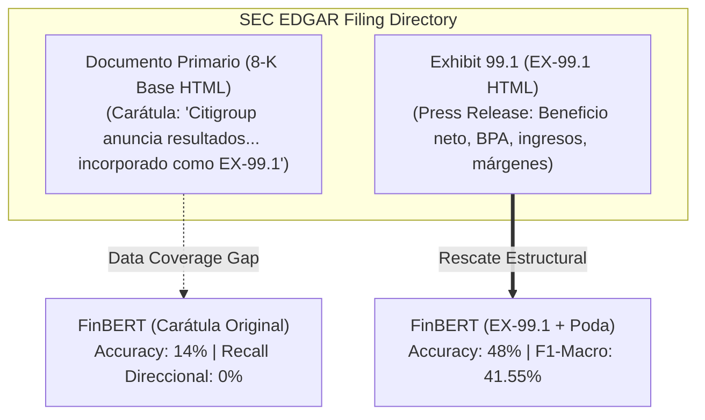
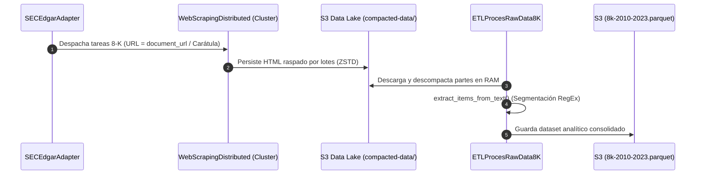

# 📄 Análisis de Impacto Técnico y Arquitectónico: Clasificador Estructural SEC 8-K y Pipeline ETL

**Proyecto:** TFM Data Science — NLP Financiero y Predicción de Sentimiento Bancario  
**Módulo:** `src/sec/`  
**Fecha:** Noviembre 2026  
**Destinatarios:** Equipo de Desarrollo TFM  

---

## 1. Contexto y Diagnóstico Previo

Durante la auditoría del modelo de análisis de sentimiento (**FinBERT**) sobre una muestra pericial de **$N=150$ filings SEC Form 8-K (2010–2023)** contrastada frente a un *Ground Truth* contable ciego, se evidenció un comportamiento dispar según el tipo de ítem:
* En **ítems administrativos y de gobernanza** (`Item 5.02`, `7.01`, `9.01`, `8.01`), la exactitud aparente era de entre el **80% y el 96%**, impulsada porque más del 90% de estos eventos son genuinamente neutros.
* En **Resultados Trimestrales (`Item 2.02`)**, el modelo original sufría un colapso total: **Accuracy del 14.0%** y un **Recall del 0.0%** en eventos alcistas y bajistas (predecía el 100% como neutros).

### El Descubrimiento: *Data Coverage Gap*
FinBERT no fallaba por incapacidad algorítmica, sino por un **déficit estructural de cobertura en el origen de datos**:
En la SEC, el documento primario del 8-K para `Item 2.02` no contiene las cuentas de resultados ni los balances. Es únicamente una **carátula procedimental (*announcement-only*)** cuya función legal es incorporar por referencia una nota de prensa adjunta en el directorio EDGAR: el **`Exhibit 99.1 (EX-99.1)`**.

---

## 2. La Nueva Pieza: `src/sec/clasificador_estructural.py`

Para resolver este problema sin introducir ruido en el sistema, se diseñó e implementó el módulo `clasificador_estructural.py`, el cual realiza dos funciones clave:
1. **Clasificación Estructural (`clasificar_item_8k`):**
   * Identifica si un ítem es puramente declarativo (`announcement_only`) o si posee contenido financiero sustantivo en su cuerpo (`substantive_body`), evaluando patrones de anexos y expresiones regulares de magnitudes económicas (`$`, `%`, *net income*, *EPS*, *dividends*, *penalties*).
2. **Poda Ligera de Ruido Legal (*Safe Harbor Boilerplate*):**
   * Elimina cláusulas de advertencia legal (*"Private Securities Litigation Reform Act"*, *"forward-looking statements"*, *"factors that could cause results to differ"*) y firmas administrativas que saturan la ventana de atención de FinBERT (512 tokens).

**Resultado Empírico en el Benchmark ($N=150$):**
* `Item 2.02`: El Accuracy se triplica de **14.0% a 48.0%** y el F1-Macro se quintuplica de **8.19% a 41.55%**.
* Conjunto Global: El Accuracy sube de **64.0% a 75.33%** y el F1-Macro pasa de **26.02% a 59.75%**.

---

## 3. Estado Actual de la Cadena ETL (`src/sec/`)

El flujo de procesamiento implementado en el repositorio opera actualmente en dos fases bien diferenciadas:

* **Punto Crítico a Considerar:** El clúster de scraping actualmente solo recibe la URL del **documento primario** (`f.document_url`). Por tanto, en el Data Lake intermedio (`compacted-data/`) **no existen los archivos `EX-99.1`**.

---

## 4. Análisis de Impacto de Integrar el Clasificador en la ETL

Se analizan los tres posibles escenarios de integración antes de fusionar los cambios a `main`:

### Escenario 1: Enriquecimiento de Metadatos en RAM (Sin llamadas a red)
Modificar `src/sec/etl_proces_raw_data_8k.py` para que, al segmentar cada ítem, ejecute `clasificar_item_8k()` sobre el texto ya extraído de la carátula.
* **Qué aportaría:**
  * Nuevas columnas en `8k-2010-2023.parquet`:
    * `category`: `"announcement_only"` | `"substantive_body"`
    * `is_announcement_only`: booleano.
    * `has_metrics`: booleano.
    * `texto_limpio_finbert`: texto podado sin *Safe Harbor* ni firmas.
* **Impacto y Riesgos:**
  * **Ruptura de Contratos:** Modifica el esquema esperado del Parquet en el Data Lake.
  * **Mantenimiento de Tests:** Requiere actualizar inmediatamente los tests unitarios en `src/test/test_etl_proces_raw_data_8k.py` para reflejar el nuevo diccionario.
  * **Limitación:** En los `Item 2.02`, `texto_limpio_finbert` seguiría conteniendo solo la carátula podada, ya que el anexo no está en disco.

---

### Escenario 2: Rescate Activo de Anexos (`EX-99.1`) en tiempo de ETL
Hacer que `ETLProcesRawData8K` descargue vía HTTP desde SEC EDGAR el anexo `EX-99.1` cada vez que detecte un `Item 2.02` catalogado como `announcement_only`.
* **Impacto y Riesgos:**
  * **Violación de Principios de Arquitectura:** El ETL de procesamiento de datos crudos se convertiría en un scraper en tiempo real, mezclando responsabilidades de procesamiento por lotes con I/O de red.
  * **Cuellos de Botella y Límite SEC:** La SEC impone un límite estricto de **10 peticiones/segundo** por User-Agent. Procesar miles de filings históricos agregando llamadas a red ralentizaría exponencialmente la ETL y causaría errores `429 Too Many Requests`.
  * **Fragilidad del Pipeline:** Si falla la conexión a EDGAR durante la ejecución del job, la ETL completa fallaría.

---

### Escenario 3: Arquitectura Desacoplada (Estrategia Recomendada para `main`)
Mantener `clasificador_estructural.py` como un módulo utilitario independiente y testeado en `src/sec/`, acompañado de sus notebooks de validación en `src/notebooks/sec/`, sin alterar la ETL actual en este merge.

* **Ventajas de esta estrategia:**
  1. **Estabilidad Total de `main`:** Los 85 tests de regresión del repositorio se mantienen al 100% en verde sin efectos colaterales.
  2. **Alineación KISS & DRY:** No se introducen dependencias de red en la ETL ni se alteran los esquemas consolidados en S3 sin una migración formal.
  3. **Rigor Académico en el TFM:** La memoria técnica y los cuadernos documentan claramente el *Data Coverage Gap* y presentan la solución validada empíricamente frente al tribunal.

---

## 5. Propuesta de Plan de Acción para Acordar en Equipo

| Fase | Alcance | Tareas Concretas |
| :---: | :--- | :--- |
| **Fase 1** *(Inmediata / Subida a `main`)* | **Consolidación y Cobertura** | 1. Promover el test unitario a `src/test/test_clasificador_estructural.py`. 2. Subir a `main` el clasificador, la memoria del hallazgo y los notebooks del benchmark. 3. Dejar el pipeline de la ETL estable e intacto. |
| **Fase 2** *(Siguiente Sprint)* | **Ingesta Distribuida de Anexos** | 1. Modificar `SECHistoricalETL` para que, en caso de `Item 2.02`, despache una tarea adicional al clúster de scraping apuntando a la URL del `EX-99.1`. 2. El clúster de scraping descarga el anexo aprovechando su arquitectura asíncrona y rotación de rate limits. 3. `ETLProcesRawData8K` une el documento primario con su anexo de forma puramente local en S3. |
| **Fase 3** *(Discusión / TFM)* | **Enfoque Híbrido NLP + Hard Rules** | Documentar en el trabajo fin de máster las limitaciones de FinBERT y proponer como línea futura un clasificador híbrido con extracción cuantitativa directa de magnitudes financieras (BPA / Beneficio Neto). |
