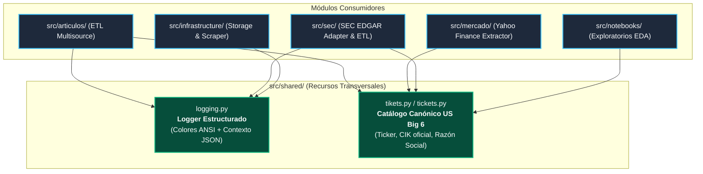

# Módulo de Recursos Transversales (`src/shared/`)

Este paquete agrupa las utilidades compartidas, estándares de observabilidad y la **fuente única de verdad** (*Single Source of Truth*) para los identificadores de entidades financieras analizadas en el proyecto **TFM-Master**.

---

## 🏛️ Arquitectura del Módulo

`src/shared/` está diseñado para ser completamente agnóstico al dominio, sirviendo como soporte transversal para todos los módulos del sistema (ETLs, adaptadores de infraestructura, extractores y notebooks):



---

## 📦 Componentes y Guía de Uso

### 1. Observabilidad y Logging Estructurado (`logging.py`)

Proporciona la clase `Logger`, que reemplaza el uso de `print()` por logs enriquecidos con niveles de severidad (`INFO`, `WARNING`, `ERROR`, `DEBUG`), marcas de tiempo exactas, colores ANSI en terminal y soporte para **contexto JSON estructurado**.

#### 🎯 ¿Por qué usar `Logger` en lugar de `print()`?
* **Nivel de severidad configurable**: Permite filtrar trazas sin modificar el código.
* **Trazabilidad y contexto**: Admite serializar diccionarios, fechas, UUIDs y modelos Pydantic (`model_dump()`) dentro del log sin romper el proceso.
* **Sin colisiones en stdout**: Deshabilita la propagación indeseada (`propagate = False`) y cuenta con formateador estilizado `StyleFormatter`.

#### 🚀 Ejemplo de uso:

```python
from shared.logging import Logger

logger = Logger("MiModulo")

# 1. Log informativo simple
logger.info("Iniciando procesamiento de datos bursátiles...")

# 2. Log con contexto estructurado (ideal para métricas y trazabilidad)
metricas = {
    "ticker": "JPM",
    "filas_procesadas": 1250,
    "tiempo_segundos": 1.45,
}
logger.info("Descarga completada con éxito", context=metricas)

# 3. Advertencias y Errores
logger.warning("Conexión lenta detectada, aplicando reintento...")
logger.error("Fallo al conectar con el endpoint", context={"error_code": 503})
```

---

### 2. Fuente Única de Verdad Bancaria (`tikets.py` & `tickets.py`)

Centraliza el universo canónico de los 6 gigantes de la banca estadounidense (**US Big 6 Banks**) con sus claves bursátiles oficiales, códigos **CIK** ante la SEC y razones sociales registradas.

#### 🔤 Soporte de Alias Dual (`tickets` / `tikets`):
Para evitar errores tipográficos o discrepancias entre miembros del equipo, el catálogo puede importarse indistintamente bajo cualquiera de las dos nomenclaturas:

```python
# Ambas formas son 100% válidas y equivalentes:
from shared.tickets import TICKETS
from shared.tikets import TIKETS

assert TICKETS == TIKETS
```

#### 📋 Datos Maestros de Entidades (`TIKETS` / `TICKETS`):

| Ticker | CIK SEC | Razón Social Oficial Registrada |
| :---: | :---: | :--- |
| **`JPM`** | `CIK0000019617` | JPMorgan Chase & Co. |
| **`BAC`** | `CIK0000070858` | Bank of America Corp /DE/ |
| **`WFC`** | `CIK0000072971` | Wells Fargo & Company/MN |
| **`C`** | `CIK0000831001` | Citigroup Inc. |
| **`GS`** | `CIK0000886982` | Goldman Sachs Group Inc. |
| **`MS`** | `CIK0000895421` | Morgan Stanley |

#### 🚀 Ejemplos de uso:

```python
from shared.tickets import TICKETS

# 1. Obtener la lista completa de tickers objetivo:
tickers = list(TICKETS.keys())
# ['JPM', 'BAC', 'WFC', 'C', 'GS', 'MS']

# 2. Obtener el CIK de un banco para la API de SEC EDGAR:
cik, razon_social = TICKETS["JPM"]
print(f"Banco: {razon_social} | CIK: {cik}")

# 3. Mapear nombres en un DataFrame de Pandas:
import pandas as pd
df = pd.DataFrame({"ticker": ["JPM", "BAC", "GS"]})
df["company_name"] = df["ticker"].map(lambda t: TICKETS.get(t, ("", ""))[1])
```

---

## ⚠️ Reglas y Buenas Prácticas

1. **Nunca escribir `print()` en producción**: Utiliza siempre `Logger("NombreDelModulo")`.
2. **Nunca duplicar listas de tickers hardcodeadas**: Si un script o notebook necesita saber cuáles son los bancos analizados, debe importar `TICKETS` o `TIKETS` desde `src/shared/`.
3. **No introducir lógica de negocio en `shared`**: Este paquete solo debe contener contratos maestros y utilidades sin dependencias de dominio.
